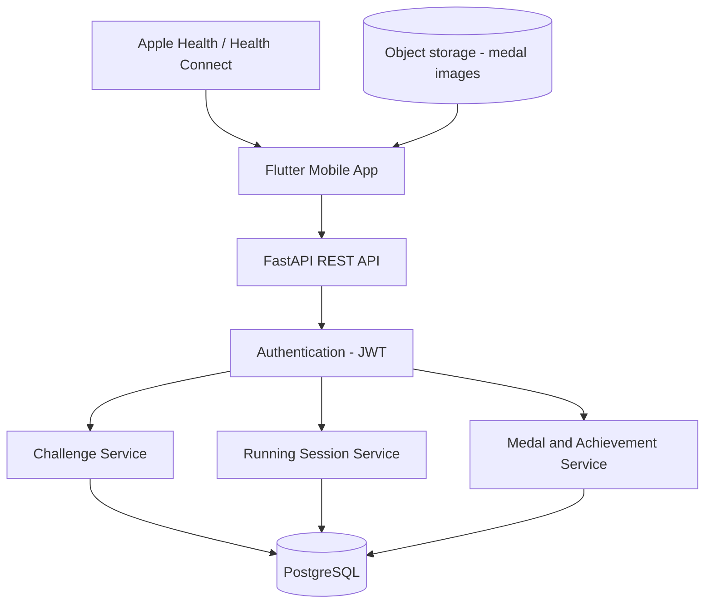

# StrideQuest

StrideQuest is a running app where every run is a quest. Runners pick a challenge, go for a run, and unlock digital medals when they complete it.

## MVP scope

The first version focuses on one complete user journey rather than many features.

1. **Discover challenges:** browse available running quests, with their distances, requirements and rewards.
2. **Start a run:** read the step count from Apple Health (iOS) or Health Connect (Android).
3. **Track progress:** show progress toward the challenge target.
4. **Complete a challenge:** validate the recorded run against the challenge rules.
5. **Unlock a medal:** award a digital medal and add it to the user's collection.
6. **View achievements:** review completed challenges and earned medals.

## Tech stack

| Part | Technology |
| --- | --- |
| Mobile app | Flutter (Dart), layered architecture (UI, logic, data), `go_router` for navigation |
| Backend | FastAPI on Python 3.12, async throughout, Pydantic schemas |
| Database | PostgreSQL |
| Medal images | Object storage (S3 or MinIO) |
| Health data | Apple Health (iOS) and Health Connect (Android), read on the device |

## Architecture

StrideQuest is a modular monolith: one FastAPI app split into service modules that share one PostgreSQL database.



- The app reads step data on the device and syncs it to the backend.
- Every API request passes through JWT authentication.
- The Running Session Service validates a run against the challenge rules and asks the Medal Service to award a medal when the run passes.
- Medal images are static files in object storage; PostgreSQL stores only their URLs.

Detailed design notes (run validation, deduplication, anti-cheat) live in issue #6.

## Project structure (planned)

```text
backend/            FastAPI app
  app/
    api/            Route handlers
    models/         Database models
    schemas/        Pydantic request and response schemas
    services/       Business logic (challenges, runs, medals)
  tests/            pytest tests
mobile/             Flutter app
  lib/
    ui/             Screens and widgets
    logic/          State and use cases
    data/           Repositories, API client, health data
  test/             flutter_test tests
docker-compose.yml  Local PostgreSQL and MinIO
```

## Getting started

> **Status:** the code is not in the repository yet. The steps below describe the planned setup and will be confirmed as issues #2 to #5 land.

### Prerequisites

- Python 3.12
- Flutter SDK (stable channel)
- Docker and Docker Compose
- Xcode (iOS) or Android Studio (Android) for running the app on a simulator or device

### Run the backend (planned)

```bash
cp .env.example .env
docker compose up -d
cd backend
python3.12 -m venv .venv
source .venv/bin/activate
pip install -r requirements.txt
uvicorn app.main:app --reload
```

The API will be available at http://localhost:8000, with interactive docs at http://localhost:8000/docs and a health check at `GET /health`.

### Run the mobile app (planned)

```bash
cd mobile
flutter pub get
flutter run
```

Reading step data needs a real device or a simulator with Apple Health or Health Connect data available.

### Lint and test (planned)

```bash
cd backend && ruff check . && pytest
cd mobile && flutter analyze && flutter test
```
