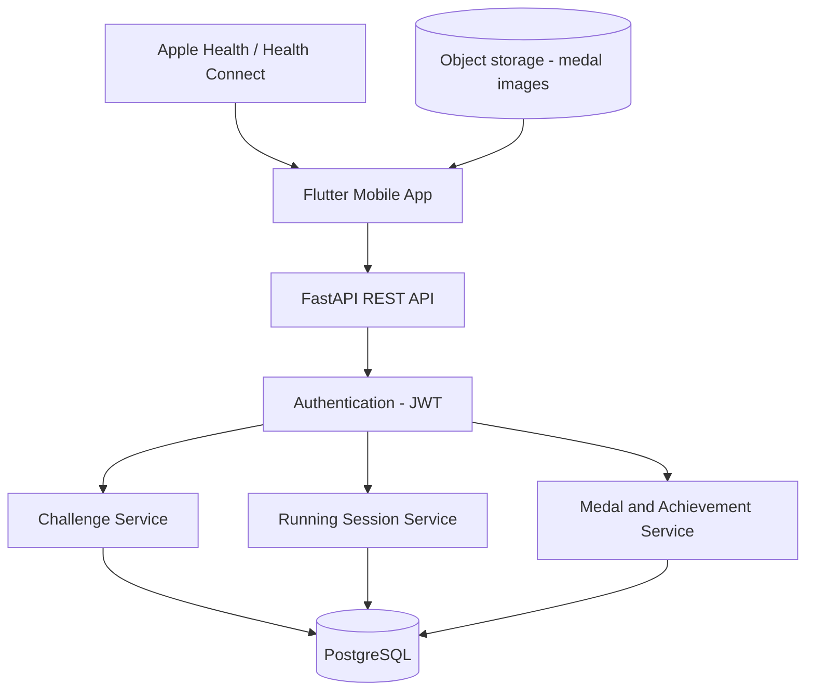

# StrideQuest

StrideQuest is a running app where every run is a quest. Runners pick a challenge, go for a run, and unlock digital medals when they complete it.

## MVP scope

The first version focuses on one complete user journey rather than many features.

1. **Discover challenges:** browse available running quests, with their distances, requirements and rewards.
2. **Start a run:** read the step count from Apple Health (iOS) or Health Connect (Android).
3. **Track progress:** show progress toward the challenge target.
4. **Complete a challenge:** validate the recorded run against the challenge rules.
5. **Unlock a medal:** award a digital medal and add it to the user's collection.
6. **View achievements:** review completed challenges and earned medals.

## Tech stack

| Part | Technology |
| --- | --- |
| Mobile app | Flutter (Dart), layered architecture (UI, logic, data), `go_router` for navigation |
| Backend | FastAPI on Python 3.12, async throughout, Pydantic schemas |
| Database | PostgreSQL |
| Medal images | S3-compatible object storage (AWS S3 in production, SeaweedFS locally) |
| Health data | Apple Health (iOS) and Health Connect (Android), read on the device |

## Architecture

StrideQuest is a modular monolith: one FastAPI app split into service modules that share one PostgreSQL database.



- The app reads step data on the device and syncs it to the backend.
- Every API request passes through JWT authentication.
- The Running Session Service validates a run against the challenge rules and asks the Medal Service to award a medal when the run passes.
- Medal images are static files in object storage; PostgreSQL stores only their URLs.

Detailed design notes (run validation, deduplication, anti-cheat) live in issue #6.

## Project structure (planned)

```text
backend/            FastAPI app
  app/
    api/            Route handlers
    models/         Database models
    schemas/        Pydantic request and response schemas
    services/       Business logic (challenges, runs, medals)
  tests/            pytest tests
mobile/             Flutter app
  lib/
    ui/             Screens and widgets
    logic/          State and use cases
    data/           Repositories, API client, health data
  test/             flutter_test tests
docker-compose.yml  Local PostgreSQL and SeaweedFS (S3-compatible storage)
```

## Getting started

> **Status:** the code is not in the repository yet. The steps below describe the planned setup and will be confirmed as issues #2 to #5 land.

### Prerequisites

| Tool | Version |
| --- | --- |
| Python | 3.12.x |
| Flutter SDK | 3.47.7 (stable channel, Dart 3.13.5) |
| Docker and Docker Compose | Docker 24 or newer, Compose v2 |
| Xcode (iOS builds) | Latest stable release from the Mac App Store |
| Android Studio (Android builds) | Latest stable release |

Supported platforms:

| Platform | Minimum version | Health data source |
| --- | --- | --- |
| iOS | iOS 15.0 | Apple Health (HealthKit) |
| Android | Android 9 (API level 28) | Health Connect |

### Run the backend (planned)

```bash
cp .env.example .env
docker compose up -d
cd backend
python3.12 -m venv .venv
source .venv/bin/activate
pip install -r requirements.txt
uvicorn app.main:app --reload
```

The API will be available at http://localhost:8000, with interactive docs at http://localhost:8000/docs and a health check at `GET /health`.

### Run the mobile app (planned)

```bash
cd mobile
flutter pub get
flutter run
```

Reading step data needs a real device or a simulator with Apple Health or Health Connect data available.

### Lint and test

Backend (with the virtual environment active):

```bash
cd backend
pip install -r requirements-dev.txt
ruff check .
ruff format --check .
pytest
```

Mobile:

```bash
cd mobile
flutter analyze
dart format --output=none --set-exit-if-changed lib test
flutter test
```

Ruff and pytest are configured in `backend/pyproject.toml`; Dart lints are configured in `mobile/analysis_options.yaml`.

## Development guidelines

- **Backend:** async throughout. Use `httpx.AsyncClient` for outgoing calls and never block the event loop. Define request and response bodies as Pydantic models, and return errors as typed fields rather than free-form strings.
- **Mobile:** keep the UI, logic and data layers separate, and use `go_router` for navigation.
- **Tests:** add tests with every feature: `pytest` for the backend, `flutter_test` for the app.
- **Language:** code, comments, docs, commit messages and merge requests are written in English.
- **Secrets:** never commit secrets. Add new settings to `.env.example` with placeholder values.

## Development workflow

1. Pick a GitLab issue and create a branch from `develop` named `<type>/<issue-id>-<short-name>`, for example `feat/1-readme`.
2. Commit small, focused changes with messages such as `feat: add challenge list endpoint`.
3. Run lint and tests locally before pushing.
4. Push the branch and open a merge request into `develop` using the default template. Link the issue with `Closes #<id>`.
5. Review the merge request in this order: correctness, tests, readability, security basics, scope.
6. Address review comments, make sure lint and tests pass locally, then merge.

`develop` is the default branch and collects finished work. `main` holds released code and is updated only by merging `develop` into it. Both branches are protected, so changes land only through merge requests.
