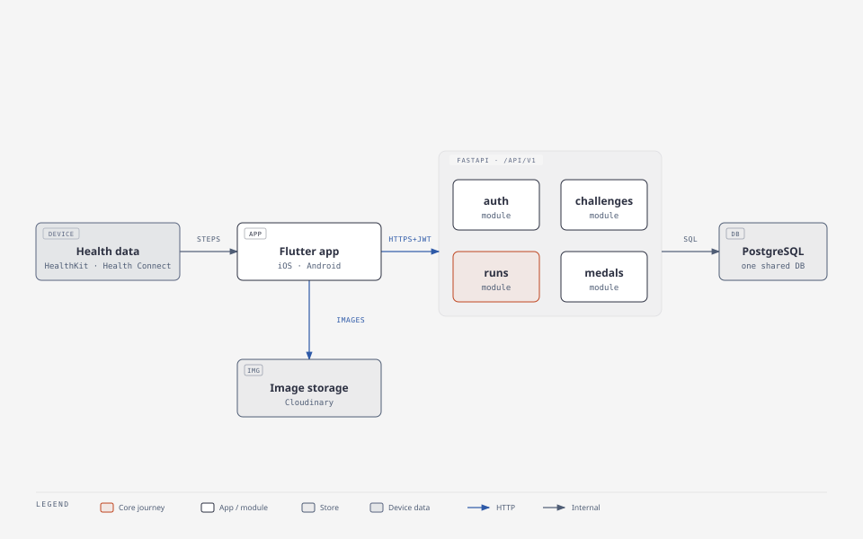

# StrideQuest

StrideQuest is a running app where every run is a quest. Runners pick a challenge, go for a run, and unlock digital medals when they complete it.

## MVP scope

The first version focuses on one complete user journey rather than many features.

1. **Discover challenges:** browse available running quests, with their distances, requirements and rewards.
2. **Start a run:** read the step count from Apple Health (iOS) or Health Connect (Android).
3. **Track progress:** show progress toward the challenge target.
4. **Complete a challenge:** validate the recorded run against the challenge rules.
5. **Unlock a medal:** award a digital medal and add it to the user's collection.
6. **View achievements:** review completed challenges and earned medals.

## Tech stack

| Part | Technology |
| --- | --- |
| Mobile app | Flutter (Dart), feature-first Clean Architecture |
| Mobile state and DI | `flutter_bloc`, `get_it` + `injectable` |
| Mobile networking and models | `dio`, `freezed` + `json_serializable` (generated with `build_runner`) |
| Mobile navigation | `go_router` |
| Backend | FastAPI on Python 3.12 as a modular monolith, async throughout, Pydantic schemas |
| Backend data access | SQLAlchemy 2 (async) with Alembic migrations |
| Database | PostgreSQL |
| Challenge and medal images | Cloudinary (uploaded by the backend, delivered by URL) |
| Health data | Apple Health (iOS) and Health Connect (Android), read on the device |

## Architecture

StrideQuest is a modular monolith: one FastAPI app split into the modules `auth`, `challenges`, `runs` and `medals`, which share one PostgreSQL database. The Flutter app is organised by the same features.



The Mermaid source of this diagram, and the other architecture diagrams, are in [`docs/architecture.md`](docs/architecture.md).

- The app reads step data on the device and syncs it to the backend.
- Protected routes need a JWT access token. Sign up, sign in, refresh, sign out and `/api/v1/health` don't; see [`docs/api/auth.md`](docs/api/auth.md).
- The `runs` module validates a run against the challenge rules from `challenges` and gets the medal from `medals` when the run passes.
- Challenge cover and medal images live in Cloudinary; PostgreSQL stores only their delivery URLs.

More detail:
- [`docs/architecture.md`](docs/architecture.md): layers, module diagrams, request and run-sync flows, data model and test strategy.
- [ADR 0001](docs/adr/0001-architecture.md): why we chose this architecture.
- [`docs/plans/README.md`](docs/plans/README.md): every non-trivial change starts with an approved plan file; the template and the approval rule.
- [`docs/health-real-device-checklist.md`](docs/health-real-device-checklist.md): what to check on a real phone for health data, which the tests and the simulator cannot show.
- [`docs/auth-screens.md`](docs/auth-screens.md): the Sign in and Sign up design from Figma, field rules, error mapping and auth task status.
- Issue #6: run validation, deduplication and anti-cheat.

## Project structure (planned)

Some folders below don't exist yet; existing code is being moved to this layout.

```text
backend/                    FastAPI app
  alembic/                  Database migrations
  app/
    core/                   Config, database, security, storage, errors
    modules/
      auth/                 router, schemas, models, repository, service, deps
      challenges/           Same files
      runs/                 Same files
      medals/               Same files
    api/v1/router.py        Mounts module routers under /api/v1
    main.py                 App factory and exception handlers
  tests/
    unit/                   Services with mocked repositories
    integration/            Routes against a PostgreSQL test database
mobile/                     Flutter app
  lib/
    core/                   DI, router, network, error, theme, config
    shared/                 Widgets and utils used by several features
    features/
      auth/                 data/, domain/, presentation/
      challenges/           Same layers
      runs/                 Same layers, plus the health data source
      medals/               Same layers
  test/                     Mirrors lib/
docs/                       Architecture, workflow, ADRs, API contracts, diagrams
docker-compose.yml          Local PostgreSQL
```

## Getting started

> **Status:** the code is not in the repository yet. The steps below describe the planned setup and will be confirmed as issues #2 to #5 land.

### Prerequisites

| Tool | Version |
| --- | --- |
| Python | 3.12.x |
| Flutter SDK | 3.47.7 (stable channel, Dart 3.13.5) |
| Docker and Docker Compose | Docker 24 or newer, Compose v2 |
| Xcode (iOS builds) | Latest stable release from the Mac App Store |
| Android Studio (Android builds) | Latest stable release |

Supported platforms:

| Platform | Minimum version | Health data source |
| --- | --- | --- |
| iOS | iOS 15.0 | Apple Health (HealthKit) |
| Android | Android 9 (API level 28) | Health Connect |

### Run the backend (planned)

```bash
cp .env.example .env
docker compose up -d --wait
cd backend
python3.12 -m venv .venv
source .venv/bin/activate
pip install -r requirements.txt
alembic upgrade head
uvicorn app.main:app --reload
```

The API will be available at http://localhost:8000, with interactive docs at http://localhost:8000/docs and a health check at `GET /api/v1/health`. Every API route is under `/api/v1`.

### Image storage (Cloudinary)

Challenge covers and medal images are stored in Cloudinary. The backend uploads them with signed requests; the mobile app never uploads, and the database keeps only the delivery URL (`https://res.cloudinary.com/<cloud>/image/upload/...`). The backend starts without these settings, and an upload then fails with a "not configured" error.

1. Create a Cloudinary account (the free plan is enough to start) and note the **cloud name**.
2. Create the folders `stridequest/challenges/covers` and `stridequest/challenges/medals` (the `stridequest` base folder is `CLOUDINARY_FOLDER`).
3. Don't create an unsigned upload preset: uploads are signed by the backend.
4. Put the credentials in `.env` (never commit it): `CLOUDINARY_CLOUD_NAME`, `CLOUDINARY_API_KEY`, `CLOUDINARY_API_SECRET`, and optionally `CLOUDINARY_FOLDER`.
5. Check the plan's quota (storage and monthly credits) before a bulk upload, and keep the original of every image outside Cloudinary.

The delivery URL accepts size and format parameters: `app.core.storage.resized_url` inserts `f_auto,q_auto,w_<width>` so a screen asks for the size it needs.

### Demo challenges

Three challenges (a run, a swim and a ride, each with a cover and bronze, silver and gold medals) are created **through the API**, as an admin, so the Challenges tab has something to show. `--with-blocked` adds a fourth that overlaps the first, to see the blocked state of the Join button. The artwork is generated by the project (`backend/demo/images/`, rebuilt with `python -m demo.make_images`) and uploaded to Cloudinary through `POST /images`, so the Cloudinary settings above must be set. Run these from `backend/` with the virtual environment active, the database up and the API running:

```bash
python -m app.scripts.create_admin you@example.com     # once, for an account you signed up with
python -m demo.load_demo --email you@example.com       # asks for the password; or set DEMO_ADMIN_PASSWORD
python -m demo.load_demo --email you@example.com --with-blocked
```

Running it again creates nothing twice: a challenge is found by its title, and a draft left by an interrupted run is published. Publishing needs an end date in the future, so once the dates in `backend/demo/load_demo.py` have passed, move them. An admin can take a challenge down in the API (`POST /api/v1/challenges/{id}/unpublish`, then `DELETE` while nobody is in it).

### Database migrations

The schema is managed by Alembic in `backend/alembic/`. The database URL comes from `DATABASE_URL` (via `DatabaseSettings` in `app/core/config.py`), never from `alembic.ini`. Migrations need only `DATABASE_URL`: the JWT and Cloudinary settings are not required, so a migration job in CI or a deploy doesn't need them. Run these from `backend/` with the virtual environment active:

```bash
alembic upgrade head
```

```bash
alembic revision --autogenerate -m "add medal awards table"
```

```bash
alembic check
```

- **Every schema change ships with a migration in the same pull request.** Review the generated file before committing: autogenerate misses some changes, such as renames.
- **`alembic check` must report no new operations** before you open the pull request.

**One-time reset for databases created before Alembic.** If your local database was created before migrations existed, recreate it instead of stamping it.

This **deletes all local database data** (the `db-data` volume). Images are in Cloudinary, not in a local volume, so nothing else is lost. If you ran an older Compose file that had the SeaweedFS `storage` service, remove its leftover volume with `docker volume rm <project>_storage-data`.

1. Stop and remove the database container:

   ```bash
   docker compose rm --stop --force db
   ```

2. Find the database volume. Its name starts with the Compose project name, which is this folder's name by default, for example `source-code_db-data`:

   ```bash
   docker volume ls --filter name=db-data
   ```

3. Delete that volume, using the exact name from the previous step:

   ```bash
   docker volume rm source-code_db-data
   ```

4. Start an empty database and wait until it is healthy:

   ```bash
   docker compose up -d --wait db
   ```

5. Create the schema:

   ```bash
   cd backend && alembic upgrade head
   ```

### Run the mobile app (planned)

```bash
cd mobile
flutter pub get
flutter run --dart-define=API_BASE_URL=http://localhost:8000/api/v1/
```

`API_BASE_URL` is the API base including `/api/v1/` (see `docs/api/auth.md`); the value above is also the default. On the Android emulator, use `http://10.0.2.2:8000/api/v1/` to reach the host machine.

To see loading, retry and error states, make the network behave badly (debug builds only; a release build ignores these):

```bash
flutter run --dart-define=SIMULATE_LATENCY_MS=2000                       # every request waits 2 s
flutter run --dart-define=SIMULATE_FAULT=offline                          # every request fails like a lost connection
flutter run --dart-define=SIMULATE_FAULT=timeout                          # every request fails like a connect timeout
flutter run --dart-define=SIMULATE_FAULT=flaky --dart-define=SIMULATE_LATENCY_MS=500   # every 3rd request fails
```

To build screens before the backend exists, use the fake remote data sources instead of the API (debug builds only; profile and release builds always use the real API):

```bash
flutter run --dart-define=API_MODE=real                                   # the API at API_BASE_URL (the default)
flutter run --dart-define=API_MODE=mock                                   # the in-memory fakes
flutter run --dart-define=API_MODE=mock --dart-define=SIMULATE_LATENCY_MS=1000   # fakes that wait 1 s per call
```

Only features that have a fake work fully in mock mode; today that is sign up, sign in and sign out. The Challenges and Active tabs still call the API and show their error state. A session from mock mode is stored like a real one, so after switching back to `real` the API rejects it and you are signed out.

Reading step data needs a real device or a simulator with Apple Health or Health Connect data available.

### Lint and test

Backend (with the virtual environment active):

```bash
cd backend
pip install -r requirements-dev.txt
ruff check .
ruff format --check .
mypy
pytest
```

Backend tests are split in two:

- **`tests/unit/`** needs no database or Docker. Run it alone with `pytest tests/unit`.
- **`tests/integration/`** runs against PostgreSQL, and includes the Schemathesis fuzz test (`pytest -m fuzz` runs only it, `pytest -m "not fuzz"` skips it). Start the database before running `pytest`:

  ```bash
  docker compose up -d --wait db
  ```

  The tests use `TEST_DATABASE_URL` from `.env` (see `.env.example`):
  - the database name must be letters, digits and underscores ending in `_test`, because each run wipes its `public` schema;
  - the database is created if it doesn't exist, migrated with `alembic upgrade head`, and each test is rolled back.

To replay the API calls of a module against a running server (`brew install hurl`; start the database and `uvicorn app.main:app` first):

```bash
backend/hurl/run.sh                          # the auth flow against http://localhost:8000/api/v1
backend/hurl/run.sh http://host:8000/api/v1  # another server
backend/hurl/run.sh --rate-limit             # also the rate limit (uses part of the per-IP budget)
```

Mobile:

```bash
cd mobile
flutter analyze
dart format --output=none --set-exit-if-changed lib test
flutter test
```

To run the sign-in flow in the real app against the real backend, start the database and the API (`uvicorn app.main:app`), boot a simulator, then:

```bash
cd mobile
flutter test integration_test/sign_in_flow_test.dart -d <device id>
```

The test creates its own user through the API, so it can be repeated. It uses the Keychain, so if an earlier run was interrupted while signed in, reset it with `xcrun simctl keychain <device id> reset`.

A flow that leaves the app (a system permission dialog, the Settings app) is tested with [Patrol](https://patrol.leancode.co) instead, on an iOS simulator only (Android is not set up). Install the CLI once, then run it with the API running and a simulator booted:

```bash
dart pub global activate patrol_cli
cd mobile
patrol test --target patrol_test/sign_in_flow_test.dart -d <device id>
```

The Patrol tests clear the app's Keychain before and after each test, so they do not leave a signed-in session for the `integration_test` ones. If `patrol test` or `pod install` stops on a Unicode error, set `LANG=en_US.UTF-8`.

Ruff and pytest are configured in `backend/pyproject.toml`; Dart lints are configured in `mobile/analysis_options.yaml`.

Regenerate code after changing a Freezed model, a `@JsonKey` or an `@injectable` registration, and commit the generated `*.g.dart`, `*.freezed.dart` and `injection.config.dart` files with the change:

```bash
cd mobile && dart run build_runner build --force-jit
```

`--force-jit` is needed because a dependency uses Dart build hooks, which the default AOT build script does not support.

## Development guidelines

- **Backend:**
  - Async throughout. Use `httpx.AsyncClient` for outgoing calls and never block the event loop.
  - Keep each module's router → service → repository layers separate. Modules talk to each other only through services.
  - Define request and response bodies as Pydantic models, and return errors as the typed `ErrorResponse` rather than free-form strings.
- **Mobile:**
  - Organise code by feature. Each feature has `data/`, `domain/` and `presentation/`; `domain/` stays pure Dart.
  - Use blocs for state and `get_it` for DI.
  - Navigate with `go_router`, passing only IDs in routes.
- **Tests:** add tests with every feature. Backend: `pytest` unit tests for services and integration tests for routes. App: `flutter_test`, `bloc_test` and `mocktail`.
- **Language:** code, comments, docs, commit messages and pull requests are written in English.
- **Secrets:** never commit secrets. Add new settings to `.env.example` with placeholder values.

## Development workflow

1. Pick a GitHub issue and create a branch from `develop` named `<type>/<issue-id>-<short-name>`, for example `feat/1-readme`.
2. Commit small, focused changes with messages such as `feat: add challenge list endpoint`.
3. Run lint and tests locally before pushing.
4. Push the branch and open a pull request into `develop` using the default template. Link the issue with `Closes #<id>`.
5. Review the pull request in this order: correctness, tests, readability, security basics, scope.
6. Address review comments, make sure lint and tests pass locally and in CI, then merge.

`develop` is the default branch and collects finished work. `main` holds released code and is updated only by merging `develop` into it. Both branches are protected, so changes land only through pull requests.

The full workflow, with its gates, is in [`CLAUDE.md`](CLAUDE.md#workflow) and drawn in [`docs/workflow.md`](docs/workflow.md).

## CI and Claude on GitHub

Three kinds of workflow run on GitHub. The design and its reasons are in [plan 014](docs/plans/014-claude-github-actions.md).

| Workflow | Runs when | What it does |
| --- | --- | --- |
| `backend-ci.yml` (job `backend`) | every PR into `develop`, every push to `develop` | `ruff check`, `ruff format --check`, `mypy`, `pytest tests/unit` and `pytest tests/integration` against a PostgreSQL 17 service |
| `mobile-ci.yml` (job `mobile`) | the same | `flutter analyze` and `flutter test` without the golden tests, on Linux |
| `mobile-ci.yml` (job `goldens`) | the same | `flutter test --tags golden` on `macos-15`; on failure, the diff images are the run's `golden-failures` artifact |
| `claude-review.yml` | a PR into `develop` is opened, marked ready for review or reopened; a collaborator comments `@claude review` on a PR | Claude reviews the PR with the `code-reviewer` agent and posts one comment, edited on later runs |
| `claude.yml` | a collaborator mentions `@claude` in an issue, an issue comment or a PR review | Claude answers as `claude[bot]`, and may push a `claude/...` branch and open a PR into `develop` |

Each CI job always reports, so it can be a required check. It runs its checks only when its folder (`backend/` or `mobile/`), `docs/api/` or its own workflow file changed, and otherwise passes in seconds. The golden tests run on macOS because the baselines in `goldens/ci/` are made on an Apple Silicon Mac, and Linux renders tens to hundreds of edge pixels differently (0.01–0.02% per image) ([plan 015](docs/plans/015-linux-goldens.md)). Update a baseline on an Apple Silicon Mac with `flutter test --update-goldens --tags golden`.

The Claude workflows run only for an `OWNER`, `MEMBER` or `COLLABORATOR` and never for a PR from a fork; the review also skips drafts and closed PRs.

Scheduled runs outside GitHub (an evening PR report on the Mac, a morning issue plan in Slack) are described in [`docs/automations.md`](docs/automations.md).

### Asking for a review

- A review runs when the PR opens or is marked ready for review. New commits do not start one: comment `@claude review` after your last push.
- To skip the review while a PR is not ready, open it as a draft.
- The review is advice. It never approves, merges or labels; merging is still up to you.

### Setting it up

The user does these once, in the repository settings:

1. **Secret `CLAUDE_CODE_OAUTH_TOKEN`:** run `claude setup-token` (Claude Code CLI) and add the token under Settings → Secrets and variables → Actions. Its usage counts against your Pro/Max subscription. To bill the API instead, add `ANTHROPIC_API_KEY` and use `anthropic_api_key:` in place of `claude_code_oauth_token:` in both Claude workflows. If the token leaks, revoke it, make a new one and replace the secret.
2. **Claude GitHub App:** install it from <https://github.com/apps/claude> for this repository only ("Only select repositories"). `claude.yml` needs it; `claude-review.yml` does not. The App issues its token only when `claude.yml` matches the version on `develop`, so a change to that workflow can be tested only after it is merged.
3. **Ruleset "Protect develop and main":** `develop` and `main` require a pull request, block force pushes and deletion, and have no bypass actors. Approvals required: 0.
4. **Ruleset "Require CI on develop":** targets `develop` only and requires the status checks `backend`, `mobile` and `goldens` (source GitHub Actions), with no bypass actors. It is separate from the ruleset above because CI does not run on PRs into `main`, so a required check there would never report.

## GitLab mirror

GitHub ([huynguyennang-agilityio/claude-code-training](https://github.com/huynguyennang-agilityio/claude-code-training)) is the primary repository. [GitLab](https://gitlab.asoft-python.com/huy.nguyennang/claude-code-training) is a read-only copy: don't push to it, and don't open issues or merge requests there (both are turned off).

GitLab can only be reached through the VPN, so nothing mirrors it automatically. After a merge to `develop` or `main`, or after pushing a tag, update it by hand from a machine on the VPN, with GitHub as `origin` and GitLab as `gitlab`:

```bash
git fetch origin --prune
git push gitlab origin/develop:refs/heads/develop origin/main:refs/heads/main --tags
```

Only `develop`, `main` and tags are mirrored. Feature branches stay on GitHub. The push never forces, so it can't overwrite anything on GitLab.

- **Check that both hosts match:** `git ls-remote origin develop main` and `git ls-remote gitlab develop main` print the same SHAs.
- **`! [rejected]`** means GitLab has a commit that GitHub doesn't: someone pushed to GitLab directly. Bring that commit to GitHub through a pull request, or discard it on GitLab, then push again.
