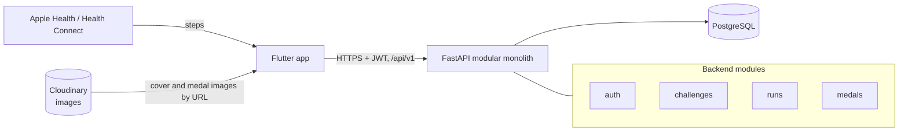
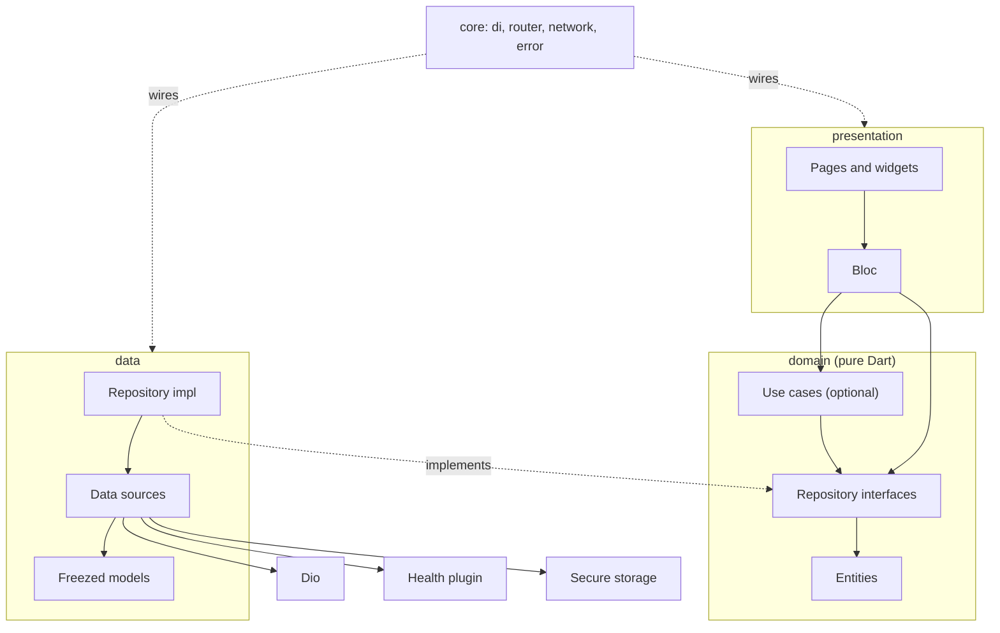
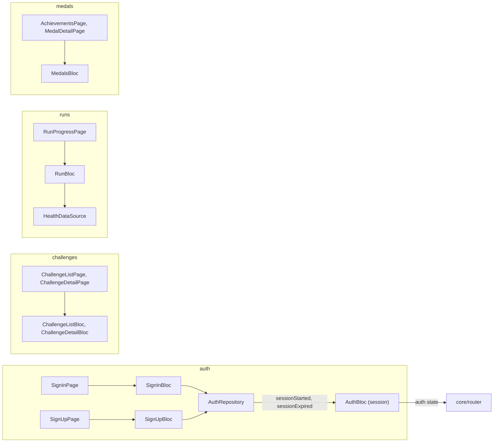
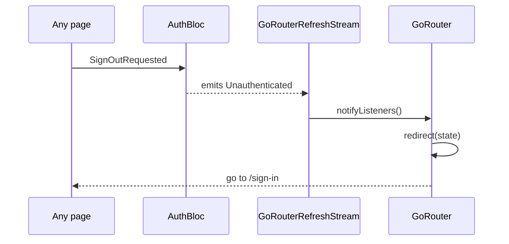
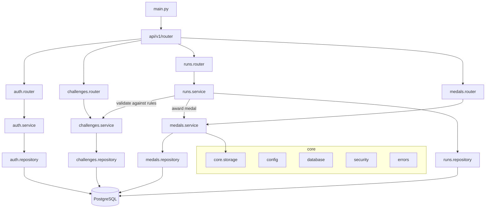
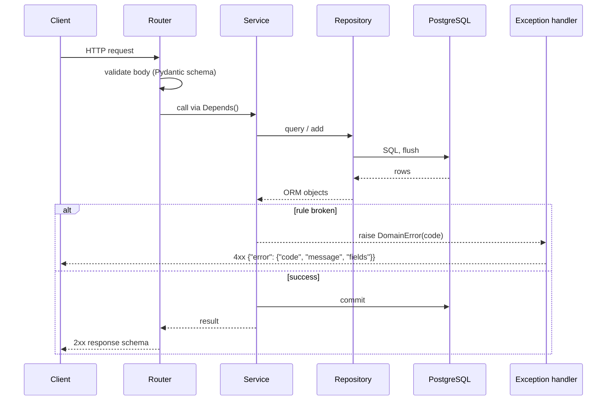
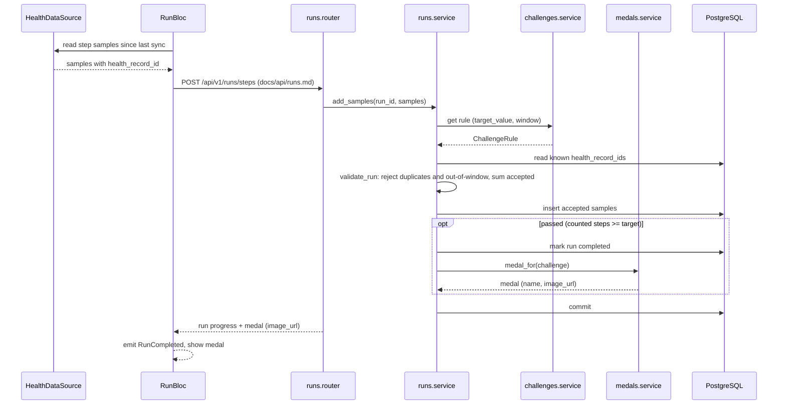
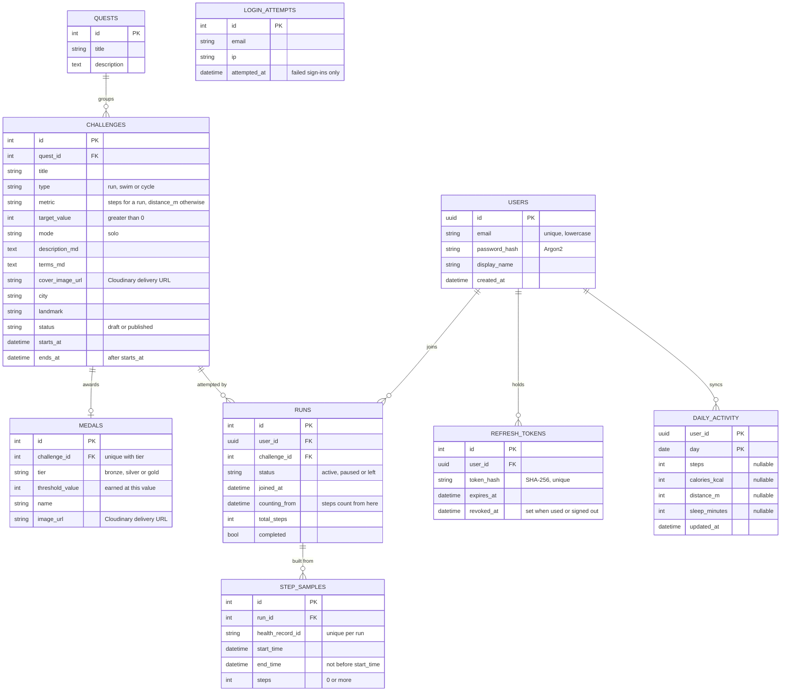
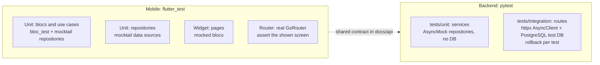

# StrideQuest architecture

This is the target architecture agreed in [ADR 0001](adr/0001-architecture.md). Existing code is being moved to it in follow-up issues, so some folders below don't exist yet.

The Mermaid blocks in this file are the source for the diagrams. Exported SVG copies of the key diagrams are in [`diagrams/`](diagrams/).

## 1. System context

The app reads steps on the device and syncs them to one FastAPI app, which validates runs and awards medals. Challenge cover and medal images are stored in Cloudinary; the database only stores their delivery URLs. Presentation copy: [`diagrams/system-context.svg`](diagrams/system-context.svg).



## 2. Mobile app

### Folder structure

```text
mobile/lib/
├── core/                  # App-wide setup, no feature logic
│   ├── config/            # Env, constants
│   ├── di/                # get_it + injectable setup
│   ├── error/             # Failure and exception types
│   ├── network/           # Dio client, auth and refresh interceptors
│   ├── router/            # GoRouter, redirect, GoRouterRefreshStream adapter
│   └── theme/             # Colors, typography, AppTheme
├── shared/                # Widgets, extensions and utils used by several features
├── features/
│   ├── auth/
│   │   ├── data/
│   │   │   ├── datasources/   # Remote (Dio) and local (secure storage)
│   │   │   ├── models/        # Freezed DTOs with toEntity()
│   │   │   └── repositories/  # Implements the domain interface
│   │   ├── domain/            # Pure Dart
│   │   │   ├── entities/
│   │   │   ├── repositories/  # Abstract interfaces
│   │   │   └── usecases/      # Optional
│   │   └── presentation/
│   │       ├── bloc/
│   │       ├── pages/
│   │       └── widgets/
│   ├── challenges/        # Same three layers
│   ├── runs/              # Same, plus data/datasources/health_data_source.dart
│   └── medals/            # Same three layers
└── main.dart
```

### Layers and dependency direction

Arrows point from the caller to what it depends on. The domain layer depends on nothing: data implements its interfaces, and presentation calls them. Presentation copy: [`diagrams/flutter-layers.svg`](diagrams/flutter-layers.svg).



### Feature map



### Auth redirect

Screens never navigate on sign-in or sign-out themselves. The router listens to `AuthBloc`, which owns only the session, and redirects. The sign-in and sign-up forms each have their own bloc; after a success, the repository announces the session on `sessionStarted` and `AuthBloc` picks it up. `GoRouterRefreshStream` is a small `ChangeNotifier` adapter we write in `core/router`; go_router does not ship it.



### Routing rules

- Routes carry IDs only, for example `/challenges/:id`. The page's bloc fetches the data. Don't pass objects through `state.extra`.
- Blocs are registered with `registerFactory` and created in the route's `BlocProvider(create: ...)`, so they close when the route is popped.
- One bloc per flow (`SignInBloc`, `SignUpBloc`, and one for each later auth flow).
- Exception: `AuthBloc` is an app-wide `@lazySingleton`, provided once above `MaterialApp.router`, because the router's `redirect` and every screen read the same auth state. It owns only the session and lives as long as the app.

## 3. Backend

### Folder structure

```text
backend/
├── alembic/                   # Migrations
├── app/
│   ├── core/
│   │   ├── config.py          # Pydantic settings
│   │   ├── database.py        # Async engine, session dependency
│   │   ├── security.py        # JWT, password hashing (pwdlib)
│   │   ├── storage.py         # Cloudinary client (signed uploads), URL helper
│   │   └── errors.py          # Domain exceptions, ErrorResponse, handlers
│   ├── modules/
│   │   ├── auth/
│   │   │   ├── router.py      # HTTP only: validate, call service, return schema
│   │   │   ├── schemas.py     # Pydantic request and response models
│   │   │   ├── models.py      # SQLAlchemy models
│   │   │   ├── repository.py  # Queries, takes an AsyncSession
│   │   │   ├── service.py     # Business rules, raises domain exceptions
│   │   │   └── deps.py        # Depends() factories, get_current_user
│   │   ├── challenges/        # Same files
│   │   ├── runs/              # Same files, plus validation.py (validate_run)
│   │   ├── medals/            # Same files
│   │   └── models.py          # Imports every module's models for Base.metadata
│   ├── api/
│   │   └── v1/
│   │       ├── router.py      # Mounts every module router under /api/v1
│   │       └── health.py      # GET /api/v1/health
│   └── main.py                # App factory, exception handlers
├── tests/
│   ├── conftest.py            # anyio backend, model registry
│   ├── unit/                  # No database: services with AsyncMock repositories, pure logic
│   └── integration/
│       ├── conftest.py        # PostgreSQL test DB from migrations, rollback per test, client
│       └── test_*.py          # Models, migrations and HTTP routes against the test DB
└── pyproject.toml
```

### Modules and layers

Modules talk to each other only through services, never through another module's repository or models. One accepted exception: the existing ORM relationships between models (`Run.challenge`, `Challenge.medals`, `Challenge.runs`) cross modules, with the import under `TYPE_CHECKING`. They map the foreign keys; don't use them to reach into another module instead of calling its service.

Reading through those relationships is allowed in one case ([ADR 0002](adr/0002-cross-module-reads.md)): a repository may eager-load another module's rows (`selectinload(Challenge.medals)`) only to nest them, read-only, in a response schema, as `ChallengeRead` nests `MedalRead`. These go through the owning module's service instead:

- filtering or sorting by another module's columns;
- writing another module's rows;
- business rules on another module's data;
- data the owning module transforms or restricts on read (for example signed URLs or hidden rows).

Adding a new cross-module relationship needs the user's approval.

The ORM cascade on `Challenge.medals` (`all, delete-orphan`) is not a write path: medals are created and changed only through `medals.service`, so don't assign or clear `challenge.medal`. Deleting a challenge may still remove its medal through that cascade, because the `medals.challenge_id` foreign key already has `ON DELETE CASCADE`.

Presentation copy: [`diagrams/backend-modules.svg`](diagrams/backend-modules.svg).



### Request flow and errors

The router validates input and calls the service. The service applies the rules and decides the transaction. The repository only runs queries and flushes. Errors come back as the typed `ErrorResponse` from [`api/auth.md`](api/auth.md). Presentation copy: [`diagrams/request-flow.svg`](diagrams/request-flow.svg).



### Run sync and medal award

This is the core MVP journey: steps synced from the device complete a challenge and unlock its medal. Presentation copy: [`diagrams/run-to-medal.svg`](diagrams/run-to-medal.svg).

Validation follows `validate_run` in `backend/app/modules/runs/validation.py`:
- it rejects duplicate and out-of-window samples before anything is stored;
- only accepted samples are saved and counted.

The endpoint path is illustrative. Its contract still has to be written in `docs/api/runs.md` before it is built ([`.claude/workflow/plan.md`](../.claude/workflow/plan.md#phase-2-design-gate), Phase 2).



### Data model

These are the current tables, defined in each module's `models.py` under `backend/app/modules/`. The `auth` module owns `users`, `refresh_tokens` and `login_attempts` ([auth contract](api/auth.md)). A row of `runs` is a user's place in a challenge (an enrollment) and `runs.user_id` is a foreign key to `users.id`. `daily_activity` holds the figures the app syncs for each calendar day.



## 4. Test strategy

Each layer is tested on its own, with the layer below it mocked. Integration tests cover the real stack on each side.



| Test | Tools | What it checks |
| --- | --- | --- |
| Bloc / use case | `bloc_test`, `mocktail` | Events produce the right ordered states, for example loading → success. |
| Widget / router | `flutter_test`, `mocktail` | A page renders each state, and navigation lands on the expected screen. |
| Backend unit | `pytest` with the anyio plugin (`@pytest.mark.anyio`), `AsyncMock` | Service rules and raised error codes, with no database. |
| Backend integration | `pytest`, `httpx.AsyncClient`, PostgreSQL from `docker compose` | Request, response and error contract against a real database. |

UI tests don't prove the screen matches the design, and backend tests don't prove the app-to-API flow works. See the verification rules in [`.claude/workflow/implement.md`](../.claude/workflow/implement.md#verify-by-ticket-type) and [`.claude/workflow/evidence.md`](../.claude/workflow/evidence.md).
