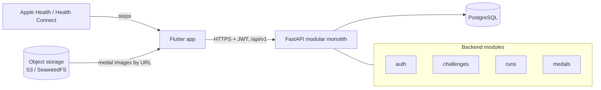
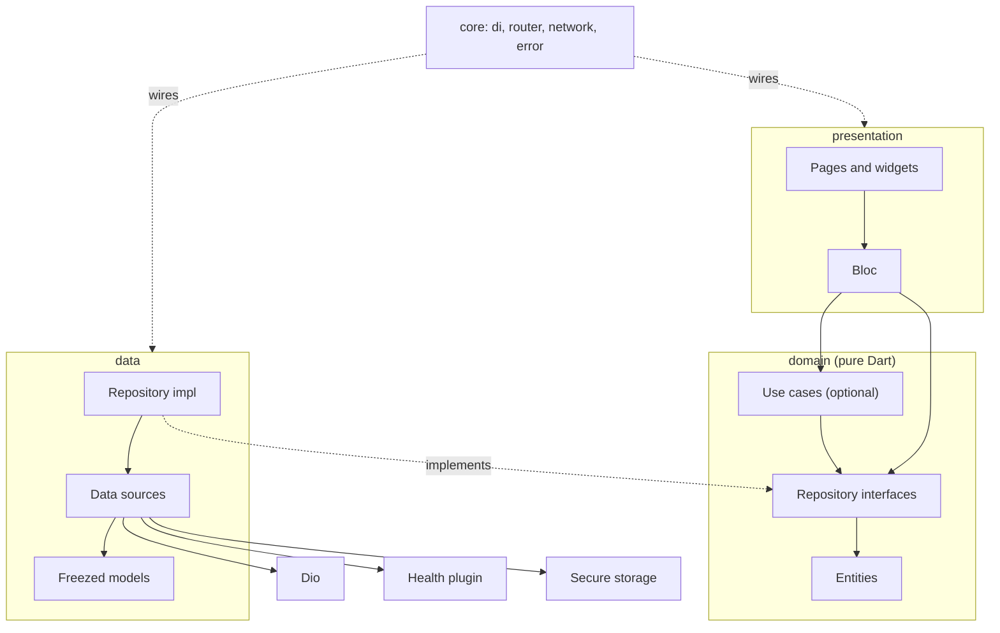
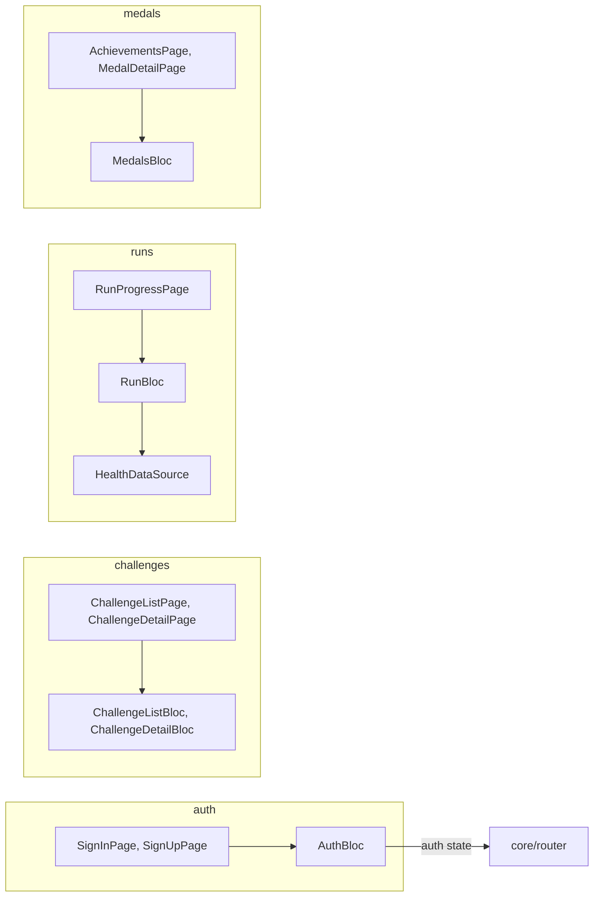
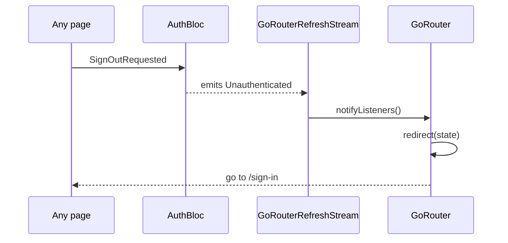
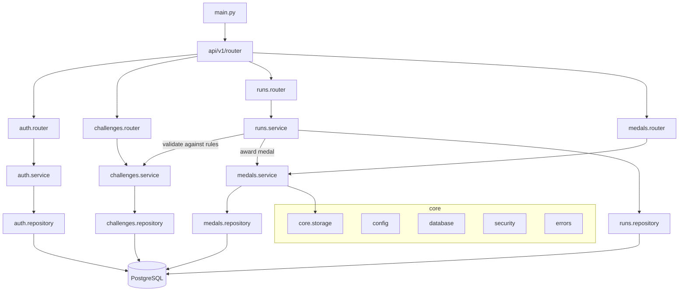
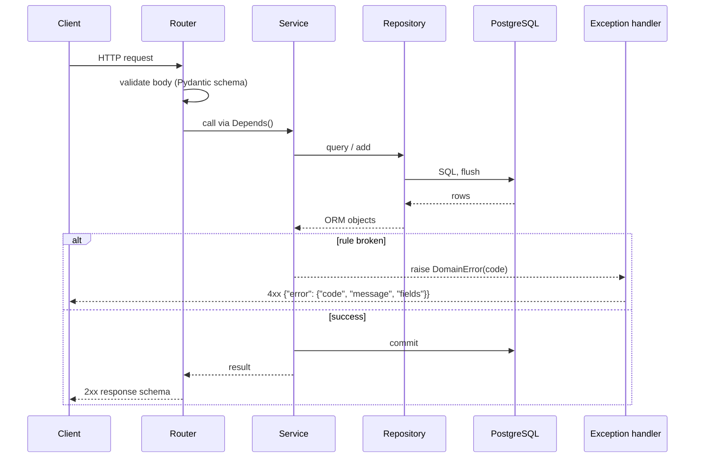
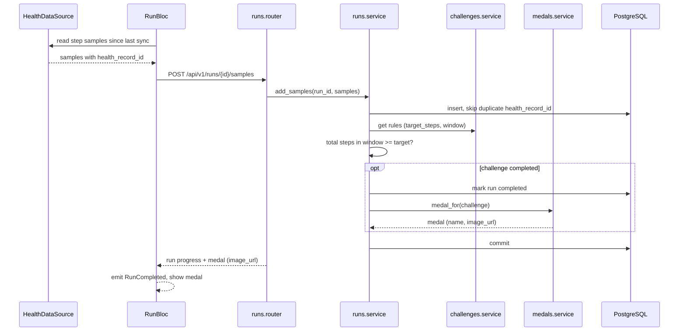
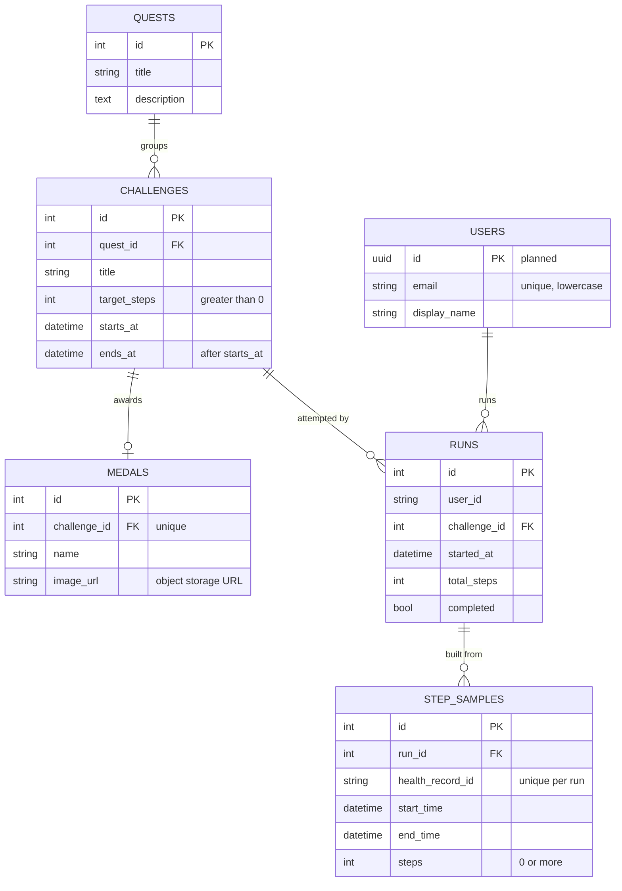
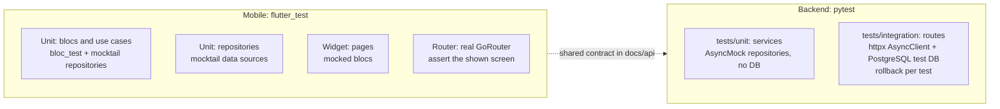

# StrideQuest architecture

This is the target architecture agreed in [ADR 0001](adr/0001-architecture.md). Existing code is being moved to it in follow-up issues, so some folders below don't exist yet.

The Mermaid blocks in this file are the source for the diagrams. Exported SVG copies of the key diagrams are in [`diagrams/`](diagrams/).

## 1. System context

The app reads steps on the device and syncs them to one FastAPI app, which validates runs and awards medals. Medal images are static files in object storage; the database only stores their URLs. Presentation copy: [`diagrams/system-context.svg`](diagrams/system-context.svg).



## 2. Mobile app

### Folder structure

```text
mobile/lib/
├── core/                  # App-wide setup, no feature logic
│   ├── config/            # Env, constants
│   ├── di/                # get_it + injectable setup
│   ├── error/             # Failure and exception types
│   ├── network/           # Dio client, auth and refresh interceptors
│   ├── router/            # GoRouter, redirect, AuthBloc listenable adapter
│   └── theme/             # Colors, typography, AppTheme
├── shared/                # Widgets, extensions and utils used by several features
├── features/
│   ├── auth/
│   │   ├── data/
│   │   │   ├── datasources/   # Remote (Dio) and local (secure storage)
│   │   │   ├── models/        # Freezed DTOs with toEntity()
│   │   │   └── repositories/  # Implements the domain interface
│   │   ├── domain/            # Pure Dart
│   │   │   ├── entities/
│   │   │   ├── repositories/  # Abstract interfaces
│   │   │   └── usecases/      # Optional
│   │   └── presentation/
│   │       ├── bloc/
│   │       ├── pages/
│   │       └── widgets/
│   ├── challenges/        # Same three layers
│   ├── runs/              # Same, plus data/datasources/health_data_source.dart
│   └── medals/            # Same three layers
└── main.dart
```

### Layers and dependency direction

Arrows point from the caller to what it depends on. The domain layer depends on nothing: data implements its interfaces, and presentation calls them. Presentation copy: [`diagrams/flutter-layers.svg`](diagrams/flutter-layers.svg).



### Feature map



### Auth redirect

Screens never navigate on sign-in or sign-out themselves. The router listens to `AuthBloc` and redirects.



### Routing rules

- Routes carry IDs only, for example `/challenges/:id`. The page's bloc fetches the data. Don't pass objects through `state.extra`.
- Blocs are registered with `registerFactory` and created in the route's `BlocProvider(create: ...)`, so they close when the route is popped.

## 3. Backend

### Folder structure

```text
backend/
├── alembic/                   # Migrations
├── app/
│   ├── core/
│   │   ├── config.py          # Pydantic settings
│   │   ├── database.py        # Async engine, session dependency
│   │   ├── security.py        # JWT, password hashing (pwdlib)
│   │   ├── storage.py         # S3 / SeaweedFS client
│   │   └── errors.py          # Domain exceptions, ErrorResponse, handlers
│   ├── modules/
│   │   ├── auth/
│   │   │   ├── router.py      # HTTP only: validate, call service, return schema
│   │   │   ├── schemas.py     # Pydantic request and response models
│   │   │   ├── models.py      # SQLAlchemy models
│   │   │   ├── repository.py  # Queries, takes an AsyncSession
│   │   │   ├── service.py     # Business rules, raises domain exceptions
│   │   │   └── deps.py        # Depends() factories, get_current_user
│   │   ├── challenges/        # Same files
│   │   ├── runs/              # Same files
│   │   └── medals/            # Same files
│   ├── api/
│   │   └── v1/router.py       # Mounts every module router under /api/v1
│   └── main.py                # App factory, exception handlers, health route
├── tests/
│   ├── conftest.py            # PostgreSQL test DB, AsyncClient, dependency_overrides
│   ├── unit/                  # Services with AsyncMock repositories
│   └── integration/           # HTTP routes against the test DB
└── pyproject.toml
```

### Modules and layers

Modules talk to each other only through services, never through another module's repository or models. Presentation copy: [`diagrams/backend-modules.svg`](diagrams/backend-modules.svg).



### Request flow and errors

The router validates input and calls the service. The service applies the rules and decides the transaction. The repository only runs queries and flushes. Errors come back as the typed `ErrorResponse` from [`api/auth.md`](api/auth.md). Presentation copy: [`diagrams/request-flow.svg`](diagrams/request-flow.svg).



### Run sync and medal award

This is the core MVP journey: steps synced from the device complete a challenge and unlock its medal. Presentation copy: [`diagrams/run-to-medal.svg`](diagrams/run-to-medal.svg).



### Data model

These are the current tables in `backend/app/models`. `users` is planned by the [auth contract](api/auth.md) and doesn't exist yet. `runs.user_id` will reference it.



## 4. Test strategy

Each layer is tested on its own, with the layer below it mocked. Integration tests cover the real stack on each side.



| Test | Tools | What it checks |
| --- | --- | --- |
| Bloc / use case | `bloc_test`, `mocktail` | Events produce the right ordered states, for example loading → success. |
| Widget / router | `flutter_test`, `mocktail` | A page renders each state, and navigation lands on the expected screen. |
| Backend unit | `pytest`, `pytest-asyncio`, `AsyncMock` | Service rules and raised error codes, with no database. |
| Backend integration | `pytest`, `httpx.AsyncClient`, PostgreSQL from `docker compose` | Request, response and error contract against a real database. |

UI tests don't prove the screen matches the design, and backend tests don't prove the app-to-API flow works. See the verification rules in [`CLAUDE.md`](../CLAUDE.md).
