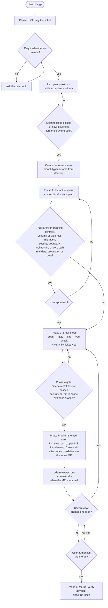
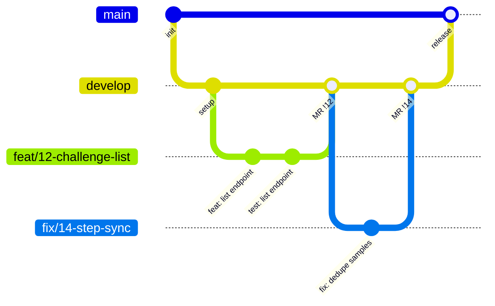
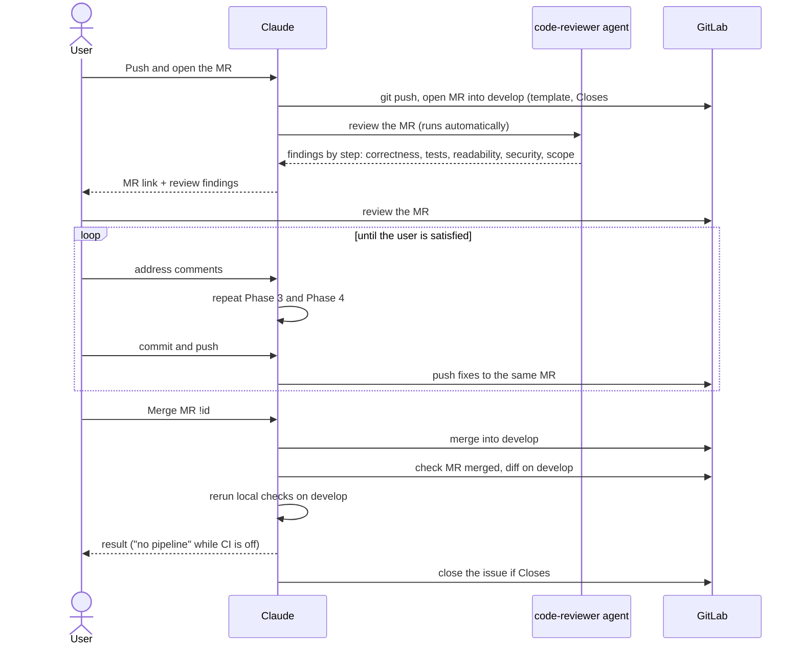

# Development workflow

These diagrams picture the workflow in [`CLAUDE.md`](../CLAUDE.md#workflow). If a diagram and `CLAUDE.md` disagree, `CLAUDE.md` wins; fix the diagram.

The Mermaid blocks are the source. Exported SVG copies of the key diagrams are in [`diagrams/`](diagrams/).

## 1. Phases and gates

Each change goes through phases 1 to 6 in order. Diamonds are gates. A gate that needs the user stops the work until they answer. Presentation copy: [`diagrams/phase-flow.svg`](diagrams/phase-flow.svg).

Phase 0 (project foundation: architecture, stack, layout, Claude rules, tooling) is not a step of each change. It is done once and revisited only when the foundation itself changes, through its own issue.

## 2. Branching

`develop` collects finished work through merge requests. `main` only receives merges from `develop` for a release. Nobody pushes directly to either.

## 3. Merge request and review

## 4. Permissions

The permission rules (what Claude may commit, push, create or merge) stay as the table in [`CLAUDE.md`](../CLAUDE.md#git-and-gitlab-permissions). They are not drawn as a diagram, so there is only one place to change them.
