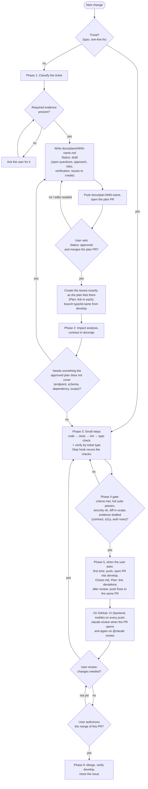
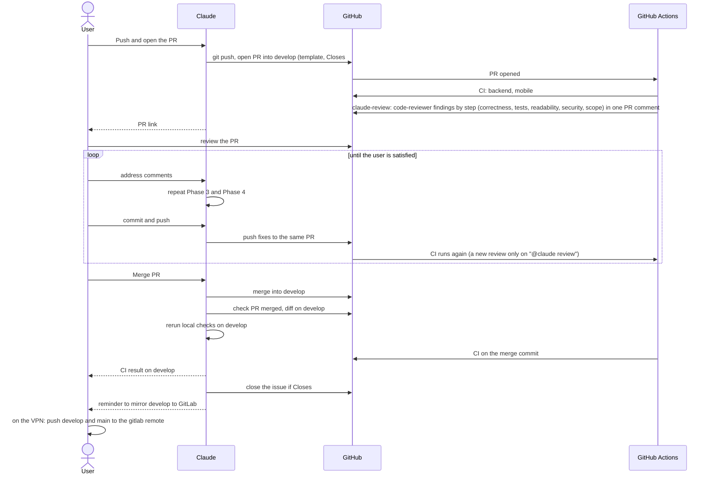
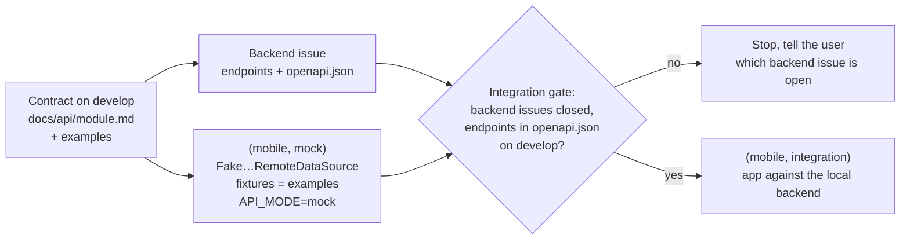

# Development workflow

These diagrams picture the workflow in [`CLAUDE.md`](../CLAUDE.md#workflow). If a diagram and `CLAUDE.md` disagree, `CLAUDE.md` wins; fix the diagram.

The Mermaid blocks are the source. Exported SVG copies of the key diagrams are in [`diagrams/`](diagrams/).

## 1. Phases and gates

Each change goes through phases 1 to 6 in order, starting from an approved plan file (`docs/plans/`). Only the user can approve a plan; approving it is not authorizing a merge. Diamonds are gates. A gate that needs the user stops the work until they answer. Presentation copy: [`diagrams/phase-flow.svg`](diagrams/phase-flow.svg).

Phase 0 (project foundation: architecture, stack, layout, Claude rules, tooling) is not a step of each change. It is done once and revisited only when the foundation itself changes, through its own issue.

## 2. Branching

`develop` collects finished work through pull requests. `main` only receives merges from `develop` for a release. Nobody pushes directly to either. GitLab is a read-only copy that the user updates by hand after a merge (see [GitLab mirror](../README.md#gitlab-mirror)).

## 3. Pull request and review

## 4. Mobile tasks: mock and integration

A mobile feature that calls an endpoint is split into a `(mobile, mock)` and a `(mobile, integration)` issue (see "Mobile tasks: mock and integration" in [`docs/workflow/plan.md`](workflow/plan.md#mobile-tasks-mock-and-integration)). The mock task starts as soon as the contract is on `develop`, in parallel with the backend. The integration gate opens only when the backend issues are closed and their endpoints are in `docs/api/openapi.json` on `develop`.

## 5. Permissions

The permission rules (what Claude may write, commit, push, create or merge, and that only the user approves a plan) stay as the table in [`CLAUDE.md`](../CLAUDE.md#git-and-github-permissions). They are not drawn as a diagram, so there is only one place to change them.
