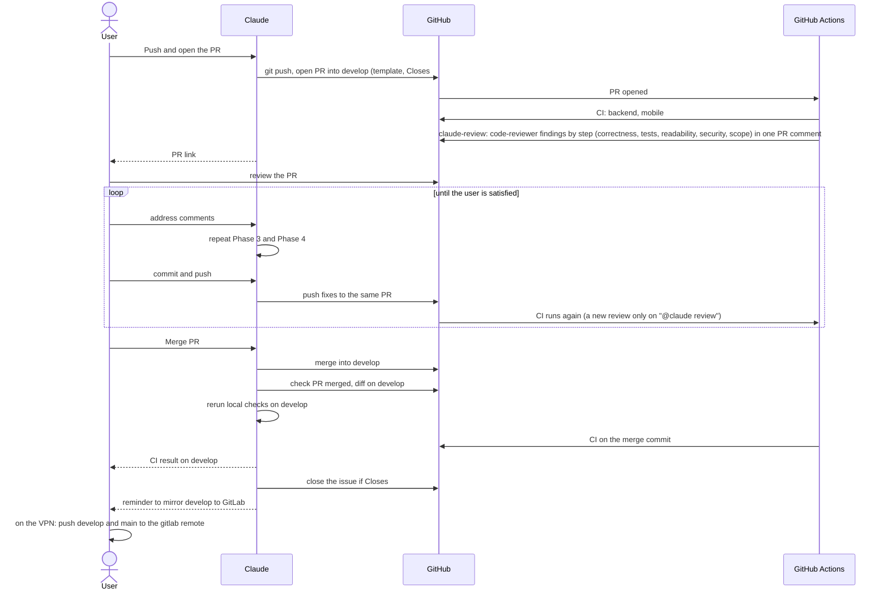
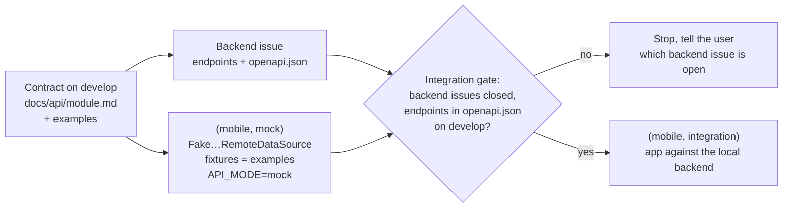
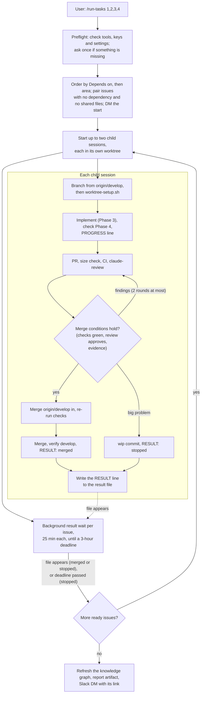

# Development workflow

These diagrams picture the workflow in [`CLAUDE.md`](../CLAUDE.md#workflow). If a diagram and `CLAUDE.md` disagree, `CLAUDE.md` wins; fix the diagram.

The Mermaid blocks are the source. Exported SVG copies of the key diagrams are in [`diagrams/`](diagrams/).

## 1. Phases and gates

Each change goes through phases 1 to 6 in order, starting from an approved plan file (`docs/plans/`). A draft plan is a Vietnamese artifact; the plan file, its branch and its PR are made by `/approve-plan` after approval ([plan 023](plans/023-task-breakdown-skill.md)). Where the Artifact tool is missing, the draft is a file on its own plan PR, as before. Only the user can approve a plan, in chat (`/approve-plan`) or, for such a plan PR, on GitHub. Approving a plan lets `/approve-plan` merge that plan PR, never a PR for an issue. Diamonds are gates. A gate that needs the user stops the work until they answer. Presentation copy: [`diagrams/phase-flow.svg`](diagrams/phase-flow.svg) (out of date since `/approve-plan`, issue #90: it shows only approval on GitHub; the Mermaid block below is current).

Phase 0 (project foundation: architecture, stack, layout, Claude rules, tooling) is not a step of each change. It is done once and revisited only when the foundation itself changes, through its own issue.

```mermaid
flowchart TD
    START(["New change"]) --> TRIV{"Trivial?<br/>(typo, one-line fix)"}
    TRIV -- yes --> P3
    TRIV -- no --> P1["Phase 1: Classify the ticket"]
    P1 --> G1{"Required evidence<br/>present?"}
    G1 -- no --> ASK1["Ask the user for it"] --> G1
    G1 -- yes --> PLAN["Draft the plan as a Vietnamese artifact<br/>(plan-artifact skill), Status: draft<br/>(open questions, approach, risks, verification,<br/>task breakdown, issues to create)<br/>no file, branch, PR or issue yet"]
    PLAN --> APPR{"User approves the plan?<br/>in chat: /approve-plan NNN<br/>(old-flow plan PR: also on GitHub)"}
    G1 -. "old flow: no Artifact tool,<br/>or a plan already open as a PR" .-> OLD["Write docs/plans/NNN-name.md<br/>Status: draft, push docs/plan-NNN-name,<br/>open the plan PR"]
    OLD -.-> APPR
    APPR -- "no / edits needed" --> PLAN
    APPR -- "in chat" --> AP["/approve-plan: write docs/plans/NNN-name.md in English<br/>(Status: approved, the user's words, Draft: link),<br/>push docs/plan-NNN-name, open the plan PR,<br/>create the issues as listed, merge the plan PR"]
    APPR -- "on GitHub<br/>(old-flow plan PR only)" --> ISSUE["Create the issues exactly as the plan lists them<br/>(Plan: link in each), numbers in a docs PR"]
    AP --> BR["Branch type/id-name from develop"]
    ISSUE --> BR
    BR --> P2["Phase 2: Impact analysis,<br/>contract in docs/api"]
    P2 --> G2{"Needs something the<br/>approved plan does not cover<br/>(endpoint, schema, dependency, scope)?"}
    G2 -- yes --> PLAN
    G2 -- no --> P3
    P3["Phase 3: Small steps<br/>code → tests → lint → type check<br/>+ verify by ticket type<br/>Stop hook reruns the checks"] --> G4
    G4{"Phase 4 gate:<br/>criteria met, full suite passes,<br/>security ok, diff in scope,<br/>evidence drafted<br/>(contract, a11y, auth rows)?"}
    G4 -- no --> P3
    G4 -- yes --> P5["Phase 5, when the user asks:<br/>first time: push, open PR into develop,<br/>Closes #id, Plan: link, deviations<br/>after review: push fixes to the same PR"]
    P5 --> REV["On GitHub: CI (backend, mobile) on every push;<br/>claude-review when the PR opens<br/>and again on @claude review"]
    REV --> UREV{"User review:<br/>changes needed?"}
    UREV -- yes --> P3
    UREV -- no --> MERGE{"User authorizes<br/>the merge of this PR?"}
    MERGE -- not yet --> UREV
    MERGE -- yes --> P6["Phase 6: Merge, verify develop,<br/>close the issue"]
```

## 2. Branching

`develop` collects finished work through pull requests. `main` only receives merges from `develop` for a release. Nobody pushes directly to either. GitLab is a read-only copy that the user updates by hand after a merge (see [GitLab mirror](../README.md#gitlab-mirror)).

## 3. Pull request and review

## 4. Mobile tasks: mock and integration

A mobile feature that calls an endpoint is split into a `(mobile, mock)` and a `(mobile, integration)` issue (see "Mobile tasks: mock and integration" in [`.claude/workflow/plan.md`](../.claude/workflow/plan.md#mobile-tasks-mock-and-integration)). The mock task starts as soon as the contract is on `develop`, in parallel with the backend. The integration gate opens only when the backend issues are closed and their endpoints are in `docs/api/openapi.json` on `develop`.

## 5. Two confirmations: `/approve-plan` and `/run-tasks`

The user confirms two things and Claude does the rest ([plan 019](plans/019-area-autopilot.md)). `/approve-plan <NNN>` approves a plan, creates its issues and merges the plan PR. `/run-tasks <issues>` (`/run-tasks 1,2,3,4` or `/run-tasks #1 #2`) takes the named issues to merge, up to two at once, each in its own child session and worktree ([plan 028](plans/028-parallel-run-tasks.md)). It asks at most once, in a preflight before the first issue; after that a small problem is fixed in place and a big one stops only its issue. Each child waits for CI and the review inside its turn and ends by writing its `RESULT:` line to a result file in the main checkout's `.git` (`run-tasks/<run-id>/<issue>.result`); the parent keeps a background command (at most 25 minutes, started again until the issue's 3-hour deadline) waiting for each running issue's file, so a new file wakes it without the app's notifications, and an issue with no file by its deadline (extended once by an hour while its child still works) counts as stopped, or as merged when its PR merged. The run ends with a Vietnamese report artifact (each issue's status, the big problems with a proposed fix, `Not verified` lines, PRs above 400 changed lines, proposed decisions) and a Slack DM with its link; the only other DM is the one at the start, except a "Run paused" DM when the parent cannot start or read child sessions while issues are still ready. A PR above 400 changed lines is listed in the report, not held back. The steps are in [`.claude/skills/approve-plan/`](../.claude/skills/approve-plan/SKILL.md) and [`.claude/skills/run-tasks/`](../.claude/skills/run-tasks/SKILL.md).

## 6. Permissions

The permission rules (what Claude may write, commit, push, create or merge, and that only the user approves a plan) stay as the table in [`CLAUDE.md`](../CLAUDE.md#git-and-github-permissions). They are not drawn as a diagram, so there is only one place to change them.
